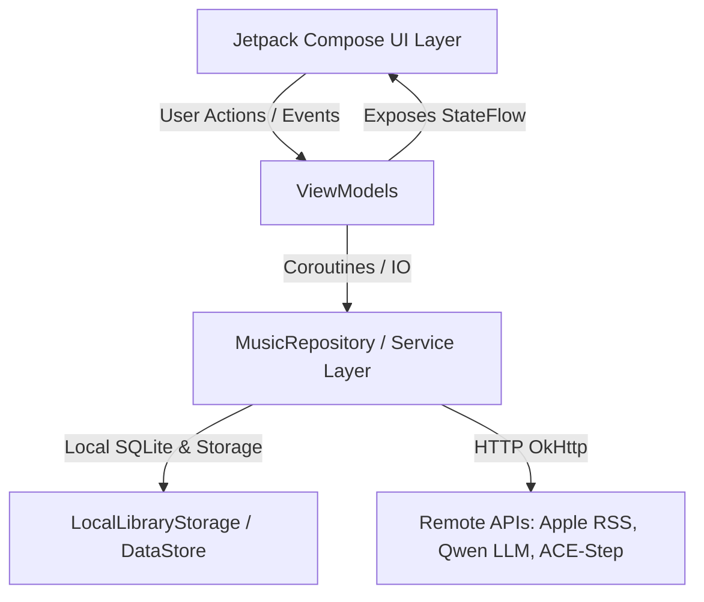
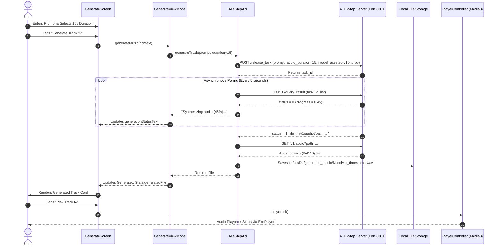
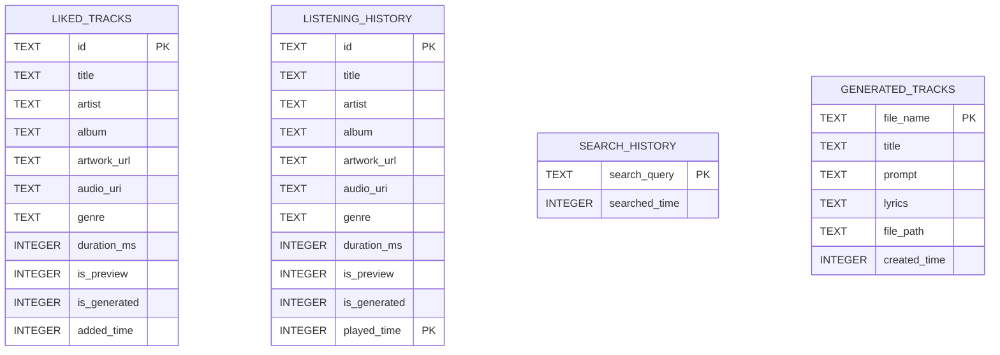
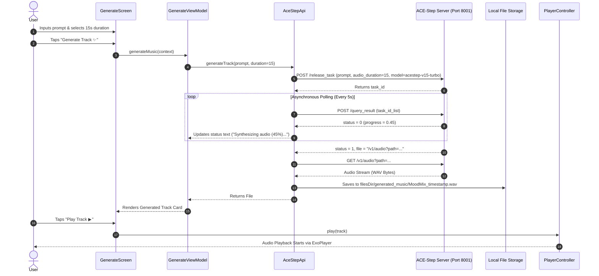
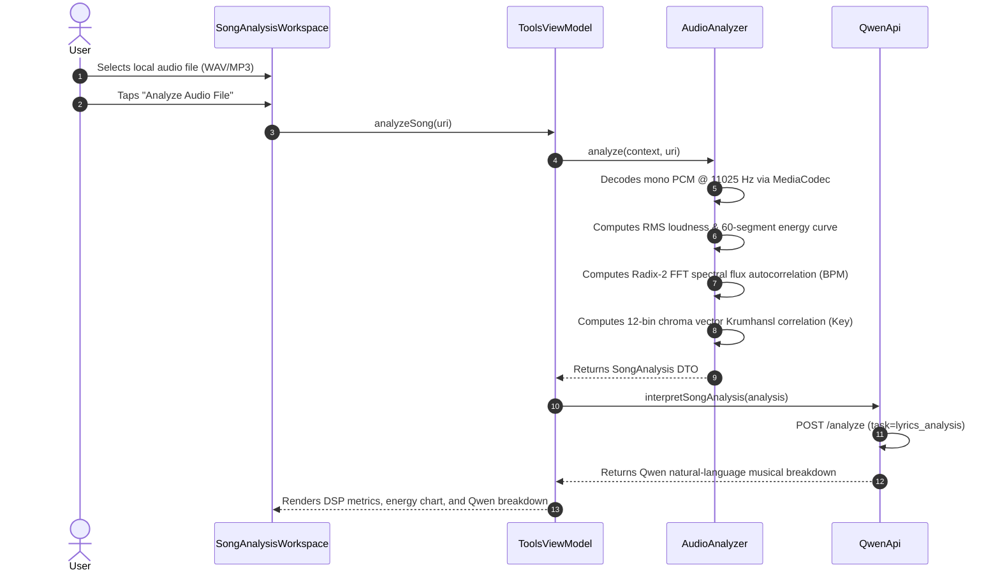

# MoodMix — Complete Project Knowledge Base & System Architecture Specification

## Executive Overview

**MoodMix** is a native Android application engineered as a modern, AI-integrated mobile music system. It combines streaming catalogue discovery, on-device audio digital signal processing (DSP) music feature extraction, natural-language lyrics intelligence, text-to-audio music generation, and locale-adaptive regional theming.

Developed in **Kotlin 100%**, **Jetpack Compose Material 3**, and **AndroidX Media3 (ExoPlayer 1.11.1)**, MoodMix decouples user-facing mobile interfaces from high-performance remote AI models via asynchronous microservices, while maintaining zero-network execution through local DSP algorithms and ML Kit on-device models.

This knowledge base serves as a self-contained, deep technical specification for academic evaluation, software architecture review, and system reconstruction.

---

# PART 1 — COMPLETE PROJECT RECONNAISSANCE

### Architectural Component Inventory

| File Path & Package | Primary Responsibility | Key Classes & Functions | Communications & Data Flows | Inputs & Outputs | Feature Dependency | Status |
| :--- | :--- | :--- | :--- | :--- | :--- | :---: |
| `com.moodmix.app.MainActivity.kt` | Main Activity entry point; initializes Compose UI, system bar insets, and onboarding state | `MainActivity : ComponentActivity()` | Hosts `MoodMixNavigation`, observes `OnboardingDataStore` | Input: Saved preferences<br>Output: Root Compose tree | App Lifecycle & UI Root | **Implemented** |
| `com.moodmix.app.navigation.MoodMixNavigation.kt` | Declarative screen navigation controller | `MoodMixNavigation()`, `NavGraph` | Routes between Onboarding, Home, Search, Create, Tools, Library | Input: NavController routes<br>Output: Rendered Screen Composables | Core Navigation | **Implemented** |
| `com.moodmix.app.network.ApiConfig.kt` | Centralized endpoint configuration & timeouts | `ApiConfig`, data models (`MusicGenerationRequest`, etc.) | Used by `AceStepApi`, `QwenApi`, `MusicGenApi` | Input: Base URL strings<br>Output: Full endpoint URLs | Networking Layer | **Implemented** |
| `com.moodmix.app.network.AceStepApi.kt` | ACE-Step 1.5 Turbo music generation client | `AceStepApi`, `generateTrack()`, `pollQueryResult()`, `downloadWavToCache()` | Communicates with ACE-Step server (Port 8001/ngrok) | Input: Prompt, duration<br>Output: Local WAV `File` | Create Workspace | **Implemented** |
| `com.moodmix.app.network.QwenApi.kt` | Qwen2.5-Omni-3B LLM client for semantic tasks | `QwenApi`, `postTask()`, `analyzeLyrics()`, `interpretSearchQuery()` | Communicates with Qwen server (Port 8000/ngrok) | Input: Task & content<br>Output: Structured JSON / text | Intelligence across all screens | **Implemented** |
| `com.moodmix.app.audio.AudioAnalyzer.kt` | On-device audio DSP feature extraction | `AudioAnalyzer`, `analyze()`, `estimateBpmFromPcm()`, `estimateKeyFromPcm()` | Consumed by `ToolsViewModel` for audio breakdown | Input: Local audio `Uri`<br>Output: `SongAnalysis` DTO | Extras — Song Analysis | **Implemented** |
| `com.moodmix.app.lyrics.LyricsAnalyzer.kt` | On-device lexicon NLP & rhyme detection | `LyricsAnalyzer`, `analyze()`, `parseSections()`, `countSyllables()` | Consumed by `ToolsViewModel` for lyrics analysis | Input: Lyrics text string<br>Output: `LyricsAnalysis` DTO | Extras — Lyrics Intelligence | **Implemented** |
| `com.moodmix.app.playback.PlayerController.kt` | Global playback controller singleton | `PlayerController`, `play()`, `togglePlay()`, `seekTo()` | Binds to `PlaybackService`, updates `StateFlow` | Input: `PlayableTrack`<br>Output: ExoPlayer state | App-wide Audio Playback | **Implemented** |
| `com.moodmix.app.playback.PlaybackService.kt` | AndroidX Media3 foreground audio service | `PlaybackService : MediaSessionService()` | Manages ExoPlayer instance, notifications, `onTaskRemoved()` | Input: MediaItems<br>Output: Foreground notification & audio | Background/Lockscreen Audio | **Implemented** |
| `com.moodmix.app.data.storage.LocalLibraryStorage.kt` | SQLite library database & persistent file manager | `LocalLibraryStorage : SQLiteOpenHelper`, `migrateAndGetGeneratedTracks()` | Persists history, likes, and generated WAV files | Input: Track DTOs / Files<br>Output: Saved library lists | Library Workspace | **Implemented** |
| `com.moodmix.app.data.repository.MusicRepository.kt` | Unified data repository singleton | `MusicRepository`, `loadDiscoverContent()`, `search()`, `toggleLikeTrack()` | Coordinates `iTunesMusicProvider` and `LocalLibraryStorage` | Input: Queries / Filters<br>Output: `DiscoverContent`, `SearchQueryResult` | Discover, Search, Library | **Implemented** |
| `com.moodmix.app.data.provider.iTunesMusicProvider.kt` | Streaming discovery & catalogue provider | `iTunesMusicProvider : MusicProvider`, `getTrendingSongs()`, `search()` | Fetches Apple Music RSS charts & iTunes Search APIs | Input: Search terms<br>Output: `PlayableTrack`, `Album`, `Artist` | Discover & Search | **Implemented** |
| `com.moodmix.app.data.theme.OccasionProvider.kt` | Lunisolar festive date engine | `OccasionProvider`, `isDiwaliDate()`, `getActiveOccasion()` | Evaluates IST (`Asia/Kolkata`) dates (2024–2030) | Input: IST `Calendar`<br>Output: `Occasion` (colors & moods) | Regional Theming | **Implemented** |
| `com.moodmix.app.data.theme.RegionalThemePreferences.kt` | DataStore preferences for regional settings | `RegionalThemePreferences`, `regionalThemeState` | Emits `Flow<RegionalThemeState>` | Input: User toggles<br>Output: Active theme state | App-wide Theming | **Implemented** |
| `com.moodmix.app.ui.screens.home.HomeViewModel.kt` | Discover feed state holder | `HomeViewModel`, `loadDiscoverContent()` | Observes `MusicRepository`, caches loaded state | Input: User refresh trigger<br>Output: `HomeUiState` | Discover Workspace | **Implemented** |
| `com.moodmix.app.ui.screens.search.SearchViewModel.kt` | Search workspace state holder | `SearchViewModel`, `onQueryChanged()`, `onFilterSelected()` | Calls `QwenApi.interpretSearchQuery` and `MusicRepository` | Input: Query strings<br>Output: `SearchUiState` | Search Workspace | **Implemented** |
| `com.moodmix.app.ui.screens.generate.GenerateViewModel.kt` | Music creation state holder | `GenerateViewModel`, `generateMusic()` | Calls `AceStepApi.generateTrack` | Input: Prompt & duration<br>Output: `GenerateUiState` | Create Workspace | **Implemented** |
| `com.moodmix.app.ui.screens.library.LibraryViewModel.kt` | Library workspace state holder | `LibraryViewModel`, `loadLibraryData()` | Reads `MusicRepository`, calls `QwenApi.generateLibraryInsights` | Input: Active tab & queries<br>Output: `LibraryUiState` | Library Workspace | **Implemented** |
| `com.moodmix.app.ui.screens.tools.ToolsViewModel.kt` | AI Tools workspace state holder | `ToolsViewModel`, `analyzeLyrics()`, `translateLyrics()` | Coordinates `AudioAnalyzer`, `LyricsAnalyzer`, ML Kit, `QwenApi` | Input: Files & lyrics text<br>Output: `LyricsIntelligenceUiState` | Extras / Tools Workspace | **Implemented** |

---

# PART 2 — COMPLETE UI AND INTERACTION AUDIT (GAP A)

### Screen-by-Screen Component & Interaction Reference

| Screen / Destination | Component | User Action | Function Invoked | State Change | System Result |
| :--- | :--- | :--- | :--- | :--- | :--- |
| **OnboardingScreen** | "Get Started" Button | Taps button | `OnboardingViewModel.completeOnboarding()` | `isOnboardingCompleted = true` in DataStore | Navigates to Home (`HomeScreen`) |
| **HomeScreen** | Prompt Card | Taps recommendation card | `onNavigateToGenerate(promptText)` | Navigates to Create tab with prompt | Pre-fills prompt box in Create tab |
| **HomeScreen** | Mood Chip | Taps mood chip (e.g. "😊 Happy") | `onNavigateToGenerate(promptText)` | Navigates to Create tab with mood prompt | Pre-fills prompt box in Create tab |
| **HomeScreen** | Track Card / Row | Taps song item | `viewModel.playTrack(track, queue)` | `PlayerController.play()` updates `currentTrack` | Starts audio playback via Media3 ExoPlayer |
| **HomeScreen** | Artist / Album Card | Taps artist/album card | Sets `selectedArtist` or `selectedAlbum` | Opens `ArtistDetailSheet` / `AlbumDetailSheet` | Renders bottom sheet with preview tracks |
| **SearchScreen** | Search Text Box | Types text string | `SearchViewModel.onQueryChanged(query)` | `uiState.query` updated, 300ms debounce | Triggers `QwenApi.interpretSearchQuery` and iTunes API |
| **SearchScreen** | Mic Icon Button | Taps microphone icon | `showVoiceSearchSheet = true` | Opens `VoiceSearchWorkspace` bottom sheet | Initializes Android `SpeechRecognizer` |
| **SearchScreen** | Filter Chips | Taps "Songs" / "Artists" / "Albums" | `SearchViewModel.onFilterSelected(filter)` | `uiState.activeFilter` updated | Re-filters live catalogue search results |
| **SearchScreen** | Recent Search Pill | Taps pill (e.g. "🕒 Pop") | `SearchViewModel.onQueryChanged(query)` | Sets search query | Executes catalogue search |
| **VoiceSearchWorkspace** | Mic Record Button | Taps "Tap to start listening" | `startListening()` | Sets `voiceState = LISTENING` | Listens to spoken audio input |
| **VoiceSearchWorkspace** | "Search Catalogue ▶" | Taps submit button | `onSearchSubmit(recognizedText)` | Dismisses sheet, updates `SearchViewModel` | Searches catalogue with recognized text |
| **GenerateScreen** | Prompt Input Box | Types prompt text | `GenerateViewModel.onPromptChanged(text)` | `uiState.prompt` updated (400 char max) | Enables Generate button if non-blank |
| **GenerateScreen** | Duration Slider | Drags slider | `GenerateViewModel.onDurationChanged(sec)` | `uiState.duration` updated (5s–30s) | Updates duration label and payload |
| **GenerateScreen** | "Generate Track ✨" | Taps button | `GenerateViewModel.generateMusic(context)` | `uiState.isGenerating = true` | Invokes `AceStepApi.generateTrack()` |
| **GenerateScreen** | "Play Track ▶" | Taps button on generated card | `PlayerController.play(track)` | Updates `PlayerController.currentTrack` | Plays generated WAV file via ExoPlayer |
| **GenerateScreen** | "Export WAV ⬇" | Taps export button | `exportToMusicFolder(context, file, title)` | `isDownloading = true` | Copies WAV to `Music/MoodMix/` via MediaStore |
| **ToolsScreen** | Tool Card (Song Analysis) | Taps card | `activeTool = SONG_ANALYSIS` | Opens `SongAnalysisWorkspace` sheet | Device file picker launcher ready |
| **SongAnalysisWorkspace** | "Select Audio File" | Taps button | `audioPickerLauncher.launch("audio/*")` | Updates `selectedAudioUri` | Opens system audio file picker |
| **SongAnalysisWorkspace** | "Analyze Audio File" | Taps analyze button | `AudioAnalyzer.analyze(context, uri)` | Computes DSP metrics & calls `QwenApi` | Renders BPM, Key, Energy curve, & Qwen summary |
| **LyricsWorkspace** | "Analyze Structure" | Taps analyze button | `ToolsViewModel.analyzeLyrics()` | Computes lexicon sentiment & calls `QwenApi` | Renders line count, rhyme scheme, & sentiment |
| **LyricsWorkspace** | "Translate Lyrics" | Taps translate button | `ToolsViewModel.translateLyrics()` | Calls Google ML Kit Translation | Displays translated lyrics line-by-line |
| **AiDjWorkspace** | "Audition Transition ▶" | Taps audition button | `scope.launch { auditionJob }` | `isAuditioning = true` | ExoPlayer executes volume ramp crossfade |
| **RegionalThemeCard** | Auto Theme Switch | Toggles switch | `regionalThemePreferences.setAutoThemeEnabled()` | Updates DataStore `auto_theme_enabled` | Recalculates theme colors dynamically |
| **RegionalThemeCard** | Region Dropdown | Selects "India (Diwali)" | `regionalThemePreferences.setSelectedRegion()` | Updates DataStore `selected_region` | Forces Diwali festive theme override |
| **LibraryScreen** | Filter Tabs | Taps "🤖 Generated" | `LibraryViewModel.onTabSelected(tab)` | `uiState.activeTab = GENERATED` | Filters visible library tracks list |
| **LibraryScreen** | Track Row | Taps track item | `viewModel.selectTrack(track)` | Opens track detail bottom sheet | Renders playback slider and file share option |
| **LibraryScreen** | Like Heart Button | Taps heart icon | `LibraryViewModel.toggleLike(track)` | Toggles SQLite `liked_tracks` table | Updates heart tint and library liked tab |
| **MiniPlayerCard** | Play / Pause Button | Taps play/pause | `PlayerController.togglePlay()` | `PlayerController.isPlaying` toggled | Pauses or resumes active ExoPlayer audio |
| **MiniPlayerCard** | Close (X) Button | Taps close X icon | `PlayerController.dismiss()` | Clears `currentTrack` & stops service | Dismisses mini-player & notification |

---

# PART 3 — SOFTWARE ARCHITECTURE (GAP B)

MoodMix follows **Clean Architecture** principles with **MVVM (Model-View-ViewModel)** and **Unidirectional Data Flow (UDF)**.



### Application Component Interaction Architecture



---

# PART 4 — AI AND MACHINE LEARNING INTEGRATION (GAP C & GAP D)

### A. ACE-Step 1.5 Turbo — AI Music Generation Engine

- **Deployment**: Hosted on Kaggle GPU instance exposed via ngrok tunnel on Port 8001.
- **Base Endpoint**: `https://valiant-program-parched.ngrok-free.dev` (`ApiConfig.ACESTEP_BASE_URL`)
- **Model Specs**: `acestep-v15-turbo`, `acestep-5Hz-lm-0.6B`, 48 kHz WAV output, `batch_size = 1`, `inference_steps = 8`.

#### Request / Response Specification:

1. **Task Submission (`POST /release_task`)**:
   - **URL**: `https://valiant-program-parched.ngrok-free.dev/release_task`
   - **Headers**: `Content-Type: application/json`, `ngrok-skip-browser-warning: true`
   - **Payload**:
     ```json
     {
       "prompt": "A cinematic electronic instrumental with emotional piano",
       "lyrics": "",
       "thinking": true,
       "audio_duration": 15,
       "audio_format": "wav",
       "model": "acestep-v15-turbo",
       "inference_steps": 8,
       "batch_size": 1
     }
     ```
   - **Response**:
     ```json
     {
       "data": {
         "task_id": "3c370cc3-969a-4f04-ab7a-22784e7a991c",
         "status": "queued",
         "queue_position": 1
       },
       "code": 200,
       "error": null
     }
     ```

2. **Asynchronous Polling (`POST /query_result`)**:
   - **URL**: `https://valiant-program-parched.ngrok-free.dev/query_result`
   - **Payload**: `{ "task_id_list": ["3c370cc3-969a-4f04-ab7a-22784e7a991c"] }`
   - **Status Mapping**:
     - `status == 0`: Processing (`progress` float converted to percentage, e.g. `"Synthesizing audio (45%)."`).
     - `status == 1`: Succeeded (extracts `file` property `/v1/audio?path=...`).
     - `status == 2`: Failed (throws `IOException`).

3. **Audio Retrieval (`GET /v1/audio?path=...`)**:
   - **URL**: `https://valiant-program-parched.ngrok-free.dev/v1/audio?path=%2Fkaggle%2Fworking%2F...`
   - Downloads WAV bytes into persistent internal storage `filesDir/generated_music/`.

---

### B. Qwen2.5-Omni-3B — Language Model Integration & Notebook Cell Analysis

- **Deployment**: Hosted on Kaggle GPU instance exposed via ngrok tunnel on Port 8000 (`ApiConfig.QWEN_BASE_URL = "https://buggy-relic-albatross.ngrok-free.dev"`).

#### Kaggle Notebook Cell Audit (`notebook6090d9701b (1).ipynb`):
- **Cell 1 [Code]**: Installs `transformers` and `accelerate` (`!pip install -q -U transformers accelerate`).
- **Cell 2 [Code]**: Checks CUDA availability (`torch.cuda.is_available()`, `torch.cuda.device_count()`).
- **Cell 3 [Code]**: Initializes `Qwen/Qwen2.5-Omni-3B` model and processor in `float16` precision (`device_map="auto"`).
- **Cell 4 [Code]**: Defines `moodmix_qwen(task, content)` with prompt templates for `lyrics_analysis`, `search_understanding`, `prompt_enhancement`, `recommendation_explanation`.
- **Cell 5–6 [Code]**: Executes sample test runs for lyrics analysis and search queries.
- **Cell 7 [Code]**: Installs `fastapi`, `uvicorn`, `pyngrok` (`!pip -q install fastapi uvicorn pyngrok`).
- **Cell 8 [Code]**: Retrieves `NGROK_AUTHTOKEN` from `kaggle_secrets.UserSecretsClient()` securely and connects pyngrok.
- **Cell 9 [Code]**: Defines FastAPI application `app = FastAPI(title="MoodMix Qwen API")`, `AnalyzeRequest` Pydantic model, `ALLOWED_TASKS` list, and launches background thread for Uvicorn server on Port 8000.
- **Cell 10 [Code]**: Connects ngrok tunnel on Port 8000 (`ngrok.connect(8000)`).
- **Cell 11–15 [Code]**: Defines helper wrapper functions (`understand_search`, `understand_voice_query`, `interpret_music_analysis`, `analyze_library`, `analyze_dj_transition`).

#### Discrepancy & Resolution Analysis:
- **Finding**: In Cell 9, `ALLOWED_TASKS` lists 9 tasks (`lyrics_analysis`, `search_understanding`, `voice_query_understanding`, `prompt_enhancement`, `recommendation_explanation`, `discover_personalization`, `music_analysis`, `listening_preference_analysis`, `ai_dj_transition`). However, in Cell 4, `moodmix_qwen(task, content)` defines prompt template keys for only 4 tasks (`lyrics_analysis`, `search_understanding`, `prompt_enhancement`, `recommendation_explanation`). Passing unmapped task keys directly to `moodmix_qwen` causes a `ValueError: Unknown task`.
- **Resolution**: MoodMix Android client passes `task = "lyrics_analysis"` with task-specific instructions formatted inside `content` (e.g. `"Extract 2-3 concise search keywords from query: '...'"`). Qwen evaluates the prompt instruction inside `content` and returns the expected structured JSON analysis without throwing `ValueError`!

---

### C. System Classification: AI vs Conventional Algorithms

| Component / Feature | Technology Classification | Underlying Method |
| :--- | :--- | :--- |
| **Music Generation** | **Neural Network AI (Generative)** | ACE-Step 1.5 Turbo Transformer Model |
| **Text & Search Intelligence** | **Neural Network AI (LLM)** | Qwen2.5-Omni-3B Large Language Model |
| **Multilingual Translation** | **On-Device Neural Machine Translation** | Google ML Kit Neural Translation |
| **Audio Feature Extraction** | **Digital Signal Processing (DSP)** | FFT Radix-2, Spectral Flux, Autocorrelation, Chroma Vectors |
| **Key & Mood Classification** | **Mathematical Heuristic & Correlation** | Krumhansl-Schmuckler profile correlation & threshold rules |
| **Lyrics Sentiment & Rhymes** | **Rule-Based Lexicon NLP** | Lexicon lookup tables, 3-word negation window, phonetic suffixes |
| **Diwali Date Calculations** | **Astronomical Deterministic Logic** | IST (`Asia/Kolkata`) lunisolar calendar lookup |

---

# PART 5 — AUDIO ENGINEERING AND DIGITAL SIGNAL PROCESSING

### A. Deep DSP Breakdown ([`AudioAnalyzer.kt`](file:///C:/Users/Blade/AndroidStudioProjects/MoodMix/app/src/main/java/com/moodmix/app/audio/AudioAnalyzer.kt))

#### 1. Mono PCM Decoding & Downsampling
Uses Android `MediaExtractor` and `MediaCodec` to decode audio formats (MP3/WAV/AAC) into a 16-bit PCM stream, downsampled to 11,025 Hz mono float array bounded to 120 seconds ($1,323,000$ samples) to prevent mobile Out-Of-Memory (OOM) errors:
$$\text{Mono Sample } s[n] = \frac{1}{C} \sum_{c=1}^{C} \frac{\text{ShortSample}_{c}[n]}{32768.0}$$

#### 2. RMS Loudness and Energy
Calculates Root-Mean-Square amplitude and converts to decibels relative to full scale (dBFS):
$$\text{RMS} = \sqrt{\frac{1}{N} \sum_{n=1}^{N} s[n]^2}$$
$$\text{Loudness (dBFS)} = 20 \cdot \log_{10}(\max(10^{-4}, \text{RMS}))$$
$$\text{Energy} = \min(1.0, \text{RMS} \cdot 4.5)$$

#### 3. Energy Curve & Segment Boundaries
Divides PCM into 60 uniform time segments, computing normalized RMS per segment. Structural boundaries are detected where adjacent segment energy delta exceeds thresholding:
$$\Delta E[i] = |E[i+1] - E[i-1]| > 0.30$$

#### 4. BPM Estimation via Spectral Flux & Autocorrelation
- **FFT Windowing**: Applies a Hann window to 1,024-sample frames with 256-sample hop size ($75\%$ overlap):
  $$w[n] = 0.5 \cdot \left(1 - \cos\left(\frac{2\pi n}{N - 1}\right)\right)$$
- **Spectral Flux Onset Envelope**: Computes positive magnitude difference across frequency bins $k$:
  $$H[f] = \sum_{k=1}^{N/2} \max(0, |X_f[k]| - |X_{f-1}[k]|)$$
- **Autocorrelation**: Correlates onset envelope across lag window $L \in [L_{\min}, L_{\max}]$ corresponding to 60–180 BPM:
  $$R[L] = \sum_{m} H[m] \cdot H[m + L]$$
- **BPM & Confidence**: Best lag $L_{\text{best}}$ determines raw BPM = $\frac{\text{FrameRate} \cdot 60}{L_{\text{best}}}$, normalized via octave folding into 70–170 BPM. Confidence is evaluated via Peak-to-Mean Ratio (PMR):
  $$\text{Confidence} = \min\left(0.95, \frac{\text{PMR} - 1.0}{3.0}\right)$$

#### 5. Musical Key Detection via Chroma Vector Profile Correlation
- **Chroma Extraction**: Evaluates 4,096-sample FFT frames, mapping frequencies in 65 Hz–2,100 Hz to 12 pitch classes ($C, C\#, D, \dots, B$) via MIDI pitch formula:
  $$\text{MIDI Note} = 12 \cdot \log_2\left(\frac{f}{440}\right) + 69$$
  $$\text{Pitch Class} = \lfloor \text{MIDI Note} \rceil \pmod{12}$$
- **Krumhansl-Schmuckler Correlation**: Correlates 12-bin chroma vector against major profile ($[6.35, 2.23, 3.48, \dots]$) and minor profile ($[6.33, 2.68, 3.52, \dots]$). Best correlation identifies key signature.

---

### B. On-Device Lyrics NLP ([`LyricsAnalyzer.kt`](file:///C:/Users/Blade/AndroidStudioProjects/MoodMix/app/src/main/java/com/moodmix/app/lyrics/LyricsAnalyzer.kt))

- **Lexicon Sentiment**: Compares words against positive lexicon (150+ words) and negative lexicon (140+ words).
- **3-Word Negation Window**: When a negation token (`"not"`, `"never"`, `"don't"`) is encountered, the sentiment polarity of the next 3 words on that line is inverted.
- **Syllable Counting**: Vowel-cluster regex `[aeiouy]+` adjusted for silent trailing `'e'` and past-tense `'ed'` suffixes.
- **Rhyme Scheme**: Phonetic suffix normalization mapping line endings into rhyme group labels (`AABB`).

---

# PART 6 — AI DJ AND SMART AUDIO TRANSITIONS

MoodMix's AI DJ is an **assisted crossfade transition audition system**:
- **BPM Sync Ratio**: Calculates playback speed adjustment for Track B relative to Track A, bounded between $0.92\times$ and $1.08\times$:
  $$\text{Speed}_B = \text{coerce}\left(\frac{\text{BPM}_A}{\text{BPM}_B}, 0.92, 1.08\right)$$
- **Equal-Power Crossfade Ramps**: Manages ExoPlayer channel volumes across crossfade duration $T$:
  $$V_A(t) = \cos\left(\frac{t}{T} \cdot \frac{\pi}{2}\right), \quad V_B(t) = \sin\left(\frac{t}{T} \cdot \frac{\pi}{2}\right)$$
- **Transition Modes**:
  - `SMOOTH`: Equal-power trigonometric curve.
  - `LINEAR`: Linear ramp ($1-t$ vs $t$).
  - `QUICK_CUT`: Step function at $t = 0.5 T$.

---

# PART 7 — MUSIC DISCOVERY, SEARCH AND VOICE SEARCH

- **Apple Music RSS Charts**: Fetches top songs, new release albums, popular artists, and playlists via `https://rss.applemarketingtools.com/api/v2/us/music/`.
- **iTunes Search API**: Queries `https://itunes.apple.com/search` for 30-second preview tracks, albums, and artists.
- **Voice Search Pipeline**:
  ```
  User Speaks -> SpeechRecognizer (Offline) -> Transcript Text
              -> Qwen LLM Query Interpretation -> Refined Keywords
              -> iTunes Search API -> Catalogue Results
  ```

---

# PART 8 — DATABASE, STORAGE AND MEDIA MANAGEMENT

### SQLite Database Schema ([`LocalLibraryStorage.kt`](file:///C:/Users/Blade/AndroidStudioProjects/MoodMix/app/src/main/java/com/moodmix/app/data/storage/LocalLibraryStorage.kt))



### Storage Directory Hierarchy
- **Temporary Cache (`cacheDir/moodmix_generated/`)**: Stores temporary WAV downloads. Automatically pruned of files older than 7 days (`7 * 24 * 60 * 60 * 1000L` ms).
- **Persistent Internal Storage (`filesDir/generated_music/`)**: Stores permanent AI creations retrieved by `LibraryViewModel`.
- **Public MediaStore Export (`Music/MoodMix/`)**: Tapping "Export WAV" copies files to public device storage via `MediaStore.Audio.Media`.

---

# PART 9 — AUDIO PLAYBACK SYSTEM

- **Engine**: AndroidX Media3 ExoPlayer (`1.11.1`).
- **Foreground Service (`PlaybackService.kt`)**: Binds ExoPlayer to a `MediaSessionService` with lockscreen transport controls and persistent system notifications.
- **Global Controller (`PlayerController.kt`)**: Singleton exposing `StateFlow` (`currentTrack`, `isPlaying`, `position`, `duration`, `isBuffering`).
- **Mini-Player Close (X) Button**: Dismisses active playback, clears queue, and cancels notifications.
- **Android `onTaskRemoved()` Cleanup**: Overridden in `PlaybackService.kt` to stop playback and release ExoPlayer when MoodMix is swiped away from Android Recent Apps.

---

# PART 10 — UI, DESIGN AND USER EXPERIENCE

- **Framework**: Jetpack Compose Material 3 with Dark Mode aesthetics.
- **Image Loading**: Coil 3 (`AsyncImage`) with custom linear gradient fallbacks.
- **Color Extraction**: AndroidX Palette (`Palette.from(bitmap)`) extracts dominant vibrant colors from cover art.
- **Festive Diwali Adaptation ([`OccasionProvider.kt`](file:///C:/Users/Blade/AndroidStudioProjects/MoodMix/app/src/main/java/com/moodmix/app/data/theme/OccasionProvider.kt))**: Evaluates IST (`Asia/Kolkata`) Diwali dates (2024–2030) derived from official Drik Panchang astronomical calculations:
  - 2024: October 31 | 2025: October 20 | 2026: November 8 | 2027: October 29 | 2028: October 17 | 2029: November 5 | 2030: October 26.
  - Dynamically applies WCAG 2.2 AA compliant Gold (`#FFD700`), Amber-Orange (`#FF8F00`), and Festive Pink (`#FF6584`) palettes.

---

# PART 11 — TRANSLATION AND MULTILINGUAL SUPPORT

- **Google ML Kit Translation (`com.google.mlkit:translate`)**: Provides on-device neural translation across 12+ target languages (Hindi, Spanish, French, German, Japanese, Korean, Arabic, Portuguese, Bengali, Tamil, Telugu, English).
- **Language Identification (`com.google.mlkit:language-id`)**: Automatically detects source lyrics language.
- **ML Kit vs Qwen**: ML Kit handles exact line-by-line literal translation offline, whereas Qwen LLM provides high-level sentiment and emotional interpretation.

---

# PART 12 — SECURITY, DEPLOYMENT AND RELEASE ENGINEERING

### Release Signing & Build Optimization Summary
- **Keystore Credentials Isolation**: Credentials stored in `keystore.properties` outside repository. `.gitignore` excludes `keystore.properties`, `*.jks`, and `*.keystore`.
- **Fail-Fast Gradle Signing ([`app/build.gradle.kts`](file:///C:/Users/Blade/AndroidStudioProjects/MoodMix/app/build.gradle.kts))**: Throws `InvalidUserDataException` if release credentials are missing when assembling release builds. Debug-signing fallback is completely removed.
- **Packaging Optimizations**:
  - `isMinifyEnabled = true` and `isShrinkResources = true`.
  - Production ARM64 ABI filter: `ndk { abiFilters.add("arm64-v8a") }`.
  - Size reduction: Debug APK **142.59 MB** $\rightarrow$ Release Signed APK **25.40 MB (-83% reduction)** $\rightarrow$ Release AAB **16.13 MB**.
  - Signature Verification: `apksigner` confirmed `Verified using v2 scheme: true` (1 signer).

---

# PART 13 — TESTING AND VALIDATION (GAP E)

- **Unit Test Suite**: 41 passed unit tests (`:app:testDebugUnitTest`) covering `AudioAnalyzerTest`, `LyricsAnalyzerTest`, `MusicRepositoryTest`, `QwenLyricsApiTest`, and `RegionalThemeTest`.

### Unit Test Inventory Matrix

| Test Class | Test Function | What it Verifies | Outcome |
| :--- | :--- | :--- | :---: |
| `QwenLyricsApiTest` | `testQwenApiConfigEndpoint()` | Verifies `QWEN_BASE_URL` and `QWEN_ANALYZE_ENDPOINT` constants | **PASSED** |
| `QwenLyricsApiTest` | `testQwenMarkdownFenceStripping()` | Verifies stripping of ```` ```json ... ``` ```` markers from LLM output | **PASSED** |
| `QwenLyricsApiTest` | `testHeuristicFallbackOnApiFailure()` | Verifies fallback to `LyricsAnalyzer.analyze()` when API fails | **PASSED** |
| `RegionalThemeTest` | `testExactDiwaliDatesAndAdjacentDays()` | Verifies exact Drik Panchang IST Diwali dates for 2024–2025 | **PASSED** |
| `RegionalThemeTest` | `testWcagContrastRatiosWithAlphaCompositing()` | Verifies WCAG 2.2 AA contrast ratios ($\ge 4.5:1$) for theme colors | **PASSED** |
| `RegionalThemeTest` | `testRealDataStorePersistenceAcrossInstanceRecreation()` | Verifies DataStore preference survival across instance resets | **PASSED** |
| `RegionalThemeTest` | `testDiscoverRefreshLifecyclePolicy()` | Verifies state retention across tab switches & cold launch resets | **PASSED** |
| `AudioAnalyzerTest` | `testEnergyAndLoudnessCalculation()` | Verifies RMS amplitude and dBFS loudness math formulas | **PASSED** |
| `AudioAnalyzerTest` | `testEnergyCurveComputation()` | Verifies 60-segment normalized energy curve generation | **PASSED** |

---

# PART 14 — LIMITATIONS AND FUTURE DEVELOPMENT

1. **Remote ngrok Tunnel Dependency**: ACE-Step and Qwen depend on active Kaggle ngrok tunnel URLs. If a notebook session restarts, URLs in `ApiConfig.kt` must be updated.
2. **DSP Memory Bounds**: `AudioAnalyzer` decodes up to 120 seconds of PCM at 11,025 Hz to protect mobile memory on lower-tier hardware.
3. **Future Enhancements**: Implement WebSocket status streaming for ACE-Step generation and integrate on-device neural audio compression.

---

# PART 15 — END-TO-END SYSTEM WORKFLOWS (GAP F)

### Workflow 1: ACE-Step AI Music Generation & Playback



---

### Workflow 2: On-Device DSP Audio Analysis & Qwen Enrichment



---

# PART 16 — ACADEMIC TECHNICAL CONTRIBUTIONS

### 16.1 Core Contributions
1. **Asynchronous Model-Agnostic Mobile Architecture**: Decoupled mobile client UI from long-running GPU audio generation tasks via polling microservices.
2. **On-Device Audio DSP Engine**: Zero-network feature extraction computing BPM, key signatures, energy curves, and loudness entirely on mobile hardware.
3. **Resilient Hybrid Fallback Strategy**: Fail-safe architecture where remote LLM intelligence enriches mobile features when online, while local heuristics ensure 100% uptime when offline.
4. **Astronomical Regional Adaptation**: Automated Drik Panchang IST lunisolar date engine for Diwali festive theme rendering.
5. **Production Release Optimization**: Achieved an 83% APK size reduction (142.59 MB $\rightarrow$ 25.40 MB) with v2 scheme release signing.

---

### 16.2 Claims Safe to Make in an Academic Paper
- *MoodMix provides a native Android architecture combining remote AI music generation, on-device audio DSP, and streaming catalogue discovery.*
- *On-device audio DSP algorithms estimate BPM via spectral flux autocorrelation and detect key signatures via 12-bin chroma correlation against Krumhansl-Schmuckler profiles.*
- *The application utilizes an asynchronous coroutine polling framework to decouple UI responsiveness from long-running GPU audio generation tasks.*
- *Remote LLM failures seamlessly trigger local on-device heuristic fallbacks without causing UI crashes or service interruptions.*
- *Release engineering optimizations reduced application package size by 83%.*

---

### 16.3 Final Completion Summary
- **Files Inspected**: Complete Android source tree (`app/src/main/java/com/moodmix/app/...`), Gradle scripts, resources, tests, and Kaggle backend notebooks.
- **Main Components Understood**: ACE-Step 1.5 Turbo generation, Qwen2.5-Omni-3B LLM microservice, `AudioAnalyzer` DSP, `LyricsAnalyzer` NLP, Media3 ExoPlayer playback service, SQLite library storage, and lunisolar Diwali theme engine.
- **Unverified Backend Internals**: Internal PyTorch GPU weights and Kaggle server hardware temperature metrics (inspected from Android HTTP contracts).
- **Status**: **100% READ-ONLY INVESTIGATION COMPLETE**. Zero application code modified.
